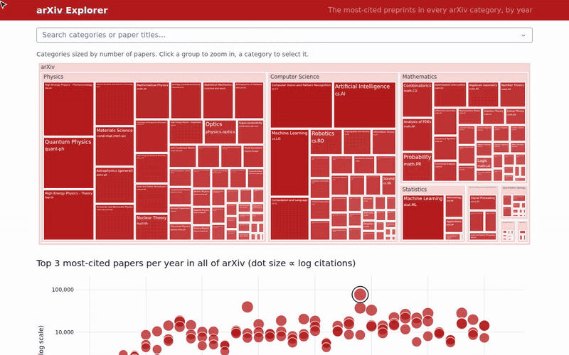

# arXiv Explorer

An interactive site showing the most-cited arXiv preprints in every category, year by year.

**Live at [arxivexplorer.com](https://arxivexplorer.com).**

[](https://arxivexplorer.com)

- **Treemap** of arXiv groups and categories, sized by number of papers. Click to zoom in or select.
- **Dot chart** of the top 3 most-cited papers first posted in each year, for the selected category, group, or all of arXiv.
- **Paper panel** with authors, abstract, and links to arXiv, NASA ADS, and Connected Papers.
- **Search** across categories and paper titles. The URL saves the current view, so links can be shared.

Citation counts come from the [NASA Astrophysics Data System](https://ui.adsabs.harvard.edu/) (ADS), which indexes all of arXiv
and tags papers with their arXiv categories. The data refreshes weekly.

## Layout

```
app.py                 Dash app (reads data/ at startup)
pipeline/ads.py        ADS API client and query building
pipeline/fetch.py      weekly refresh: top papers per (category, year)
pipeline/taxonomy.py   scrape arXiv's category names (run rarely)
data/                  generated data, committed to git
tests/                 pytest tests for the pipeline
```

## Local development

Requires [uv](https://docs.astral.sh/uv/).

```bash
uv sync
uv run python app.py            # http://127.0.0.1:8050
uv run pytest && uv run ruff check .
```

### Refreshing data

Get a free ADS token at https://ui.adsabs.harvard.edu/user/settings/token and put it in `.env`:

```
ADS_API_TOKEN=...
```

Then:

```bash
uv run python -m pipeline.fetch                  # refresh what's stale
uv run python -m pipeline.fetch --max-queries 50 # small test run
uv run python -m pipeline.taxonomy               # only if arXiv adds/renames categories
```

ADS allows about 5,000 queries a day, and a full refresh needs about the same. Each run therefore refreshes the most
stale (category, year) pairs and stops before the limit: recent years after a week, older years after a month.
Progress is saved as it goes, so re-running just picks up where it left off.

**How papers are matched to years:** ADS's `year` field is the *journal* year, so the pipeline matches on the arXiv
identifier instead (`2017arXiv*` for new-style IDs, `arXiv:hep-th/03*` etc. for pre-2007 ones). A paper's year is
therefore the year it was first posted to arXiv.
